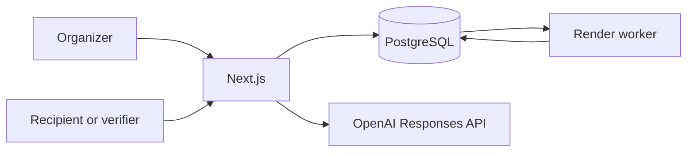

# AuraSeal architecture

## ADR 001 — Transactional issuance and container rendering

Next.js serves the dashboard and public pages. PostgreSQL stores private previews, agent plans, issued claims and render jobs. A separate worker renders the same declarative certificate artwork used in the web preview. Resvg rasterizes the artwork and FFmpeg encodes H.264. Bounded assets live in private database storage for a small deployment footprint. This increases backup size and database bandwidth.

Opaque session tokens scope organizer requests to their organization. PostgreSQL row-level policies enforce tenant data access for the non-superuser application role. Public APIs read the issued-record snapshot and expose an allowlisted subset. One approval transaction creates the records, audit trail and jobs. Reissue atomically marks the predecessor superseded. Render workers use exclusive leases and cross-process retries.

## Data contracts

Results files require `participant_ref`, `display_name`, `tier` and `rank`. Only the first XLSX sheet is read. The extension, archive size, record count, column rules and values are validated before an import is written. Participant references are normalized for duplicates and hashed in issued records.

Protected API endpoints use an organizer session. Mutations check the canonical origin. The public `/v/:id` route and `GET /api/verify/:id` resolve record status. Exports are available under `/api/verify/:id/download/:format` when the credential is valid. The verification ID is random and unique. Internal row, account and job IDs do not appear on public routes.

Same-import approval is idempotent. A repeated row with matching facts reuses the existing record. Conflicting facts require organizer review. Reissue creates a replacement for the same approved facts and moves the original verification link to superseded status.
